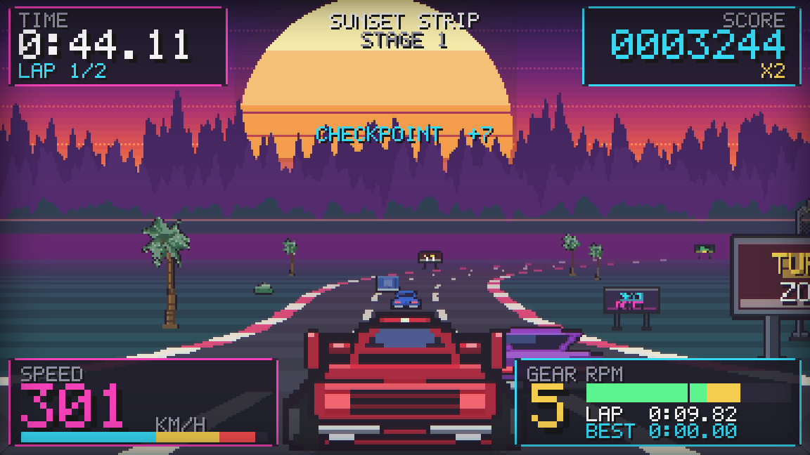
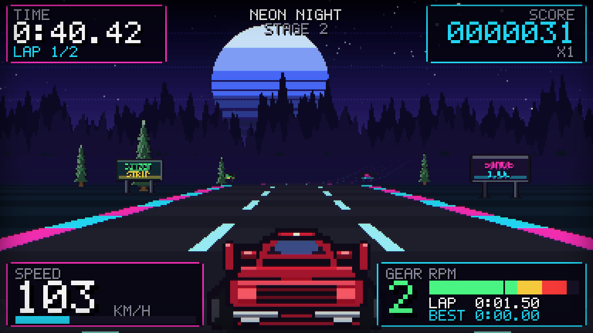
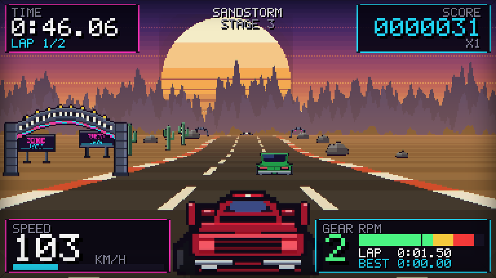
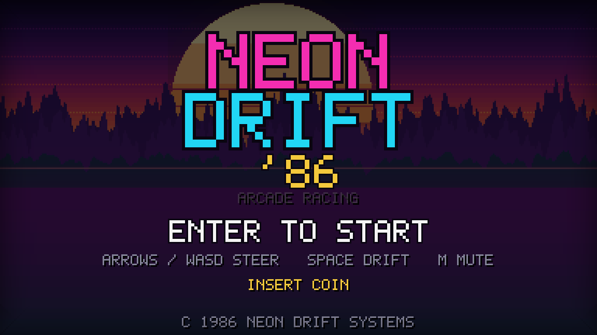
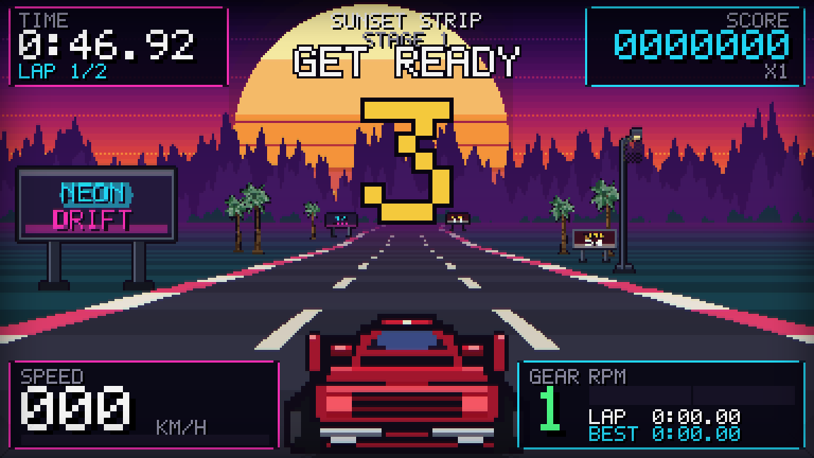
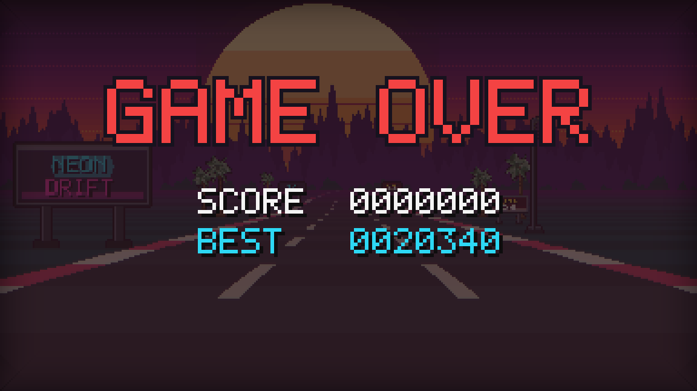
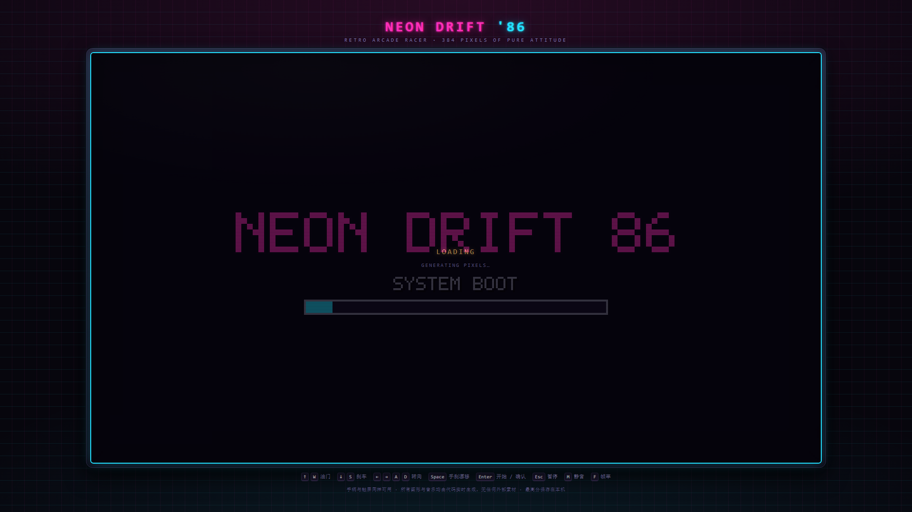

# NEON DRIFT '86

[](https://github.com/83079Vermont/neon-drift-86/actions/workflows/ci.yml)
[](LICENSE)
[](#技术上有什么特别的)

> 一个纯 HTML5 的**复古街机赛车游戏**。伪 3D 路面、程序化像素美术、芯片音乐合成——
> **零外部素材、零网络请求**，双击一个 HTML 文件就能玩。

> [!NOTE]
> ### 这是一个用于测试 DeepSeek V4.1 Flash（1017）模型能力的项目
>
> 本仓库的全部内容 —— 游戏设计、7 个 ES5 模块、程序化像素美术、芯片音乐合成、单文件打包器，
> 以及那套在 Node 里自行实现 Canvas2D 的**无头验证工具链** —— 均由该模型在一次会话中端到端产出
> （含 5 个子智能体并行开发与交叉验证）。
>
> 因此它适合作为一个**参考样本，用于评估该模型在「前端 / 图形 / 游戏开发」方向的能力**：
> 伪 3D 渲染管线、像素级美术生成、Web Audio 合成、跨模块接口契约设计，以及
> 「自己造工具来验证自己」的闭环能力。若要横向对比，下面几项都是可复现、可量化的：
>
> - `node tools/run-all.mjs` —— 61 项契约断言 + 12 张真实渲染帧，期望 `PASS WITH ISSUES`、exit 0
> - `node tools/build.mjs` 连跑两次比对哈希 —— 期望单文件包**逐字节可复现**
> - `node tools/es5-guard.mjs` —— 期望 8 个文件全清（守住 ES5 语法与无网络约束）
> - 浏览器打开 `index.html`，窗口 1920×1080 —— 期望 canvas 为 1536×864（整数 4 倍放大）
>
> 需要说明的是：本项目的**原始需求只有一句话**（“制作一个 HTML5 的复古风格单机赛车游戏”），
> 上面列出的验证结论均来自该项目自带的测试套件，可自行复跑核对。
>
> *This repository is a showcase for evaluating **DeepSeek V4.1 Flash (1017)**: every line of it,
> including the headless Canvas2D verification harness, was produced by the model in a single
> session. Re-run the commands above to check the claims yourself.*

```
   ███╗   ██╗███████╗ ██████╗ ███╗   ██╗
   ████╗  ██║██╔════╝██╔═══██╗████╗  ██║
   ██╔██╗ ██║█████╗  ██║   ██║██╔██╗ ██║
   ██║╚██╗██║██╔══╝  ██║   ██║██║╚██╗██║
   ██║ ╚████║███████╗╚██████╔╝██║ ╚████║    D R I F T   '8 6
   ╚═╝  ╚═══╝╚══════╝ ╚═════╝ ╚═╝  ╚═══╝
```

---

## 画面

三个关卡各有独立的天空、地面、路肩与布景配色：

| SUNSET STRIP | NEON NIGHT | SANDSTORM |
|---|---|---|
|  |  |  |

| 标题页 | 发车倒计时 | GAME OVER |
|---|---|---|
|  |  |  |

真实浏览器中的成品页面（1920×1080 下自动整数放大到 4 倍，扫描线叠加在输出分辨率上）：



---

## 快速开始

**方式一（推荐，最简单）**：直接双击 **`neon-drift-86.html`**。
单文件、约 240 KB、完全自包含，`file://` 协议下就能跑，没有任何依赖。

**方式二（开发用，多文件）**：双击 **`index.html`**。
它按固定顺序加载 `src/*.js`（经典 `<script>`，不用 ES module，所以 `file://` 也不会被 CORS 拦）。

**方式三（部署）**：把整个目录丢进任意静态服务器即可。

启动后按 **`Enter`** 开始；游戏内按 **`M`** 静音（浏览器要求先有用户操作才允许出声，所以第一次按键/点击时音频才会解锁）。

---

## 操作

| 按键 | 作用 |
|---|---|
| `↑` / `W` | 油门 |
| `↓` / `S` | 刹车 |
| `←` `→` / `A` `D` | 转向 |
| `Space` | 手刹漂移 |
| `Enter` | 开始 / 确认 |
| `Esc` | 暂停（有暂停菜单） |
| `M` | 静音 |
| `F` | 显示帧率 |

* **手柄**：左摇杆 / 十字键转向，RT 油门、LT 刹车，热插拔自动识别。
* **触屏**：左半屏转向，右半屏上油门下刹车，已阻止页面滚动与缩放。

---

## 玩法

* **3 个关卡**，每关 **2 圈**：`SUNSET STRIP`（日落）→ `NEON NIGHT`（霓虹夜）→ `SANDSTORM`（沙暴黎明）。三个主题的天空、地面、路肩、装饰物配色完全不同。
* **检查点计时**：每关起表时间由赛道长度推算（不是固定值）。跑过检查点加时，时间归零即 `GAME OVER`。
* **越野**：`|横向位置| > 1` 会剧烈掉速、车身抖动、响起胎声，但不会停死，可以开回路面。
* **撞车**：撞上 AI 车流掉约 35% 速度，震屏 + 闪白，并有约 1.2 秒无敌时间（无敌期内二次碰撞不再扣速）。
* **漂移**：高速 + 转向时拉手刹，转向权限提升约 42%，出弯有速度损失，并留下胎痕。
* **档位 / 转速**：5 档，转速表在每档内锯齿变化，换挡瞬间掉转并有换挡音，引擎声随转速变调。
* **最高分与最佳圈速**存在本机（`localStorage`，键前缀 `neondrift86.`）。

---

## 技术上有什么特别的

| 方面 | 做法 |
|---|---|
| **画面** | 经典**伪 3D 赛道**（Out Run / Pole Position 一脉）：赛道由上千个 segment 组成，带曲率与高度，按透视除法投影；远→近画家算法绘制路边精灵；指数雾收敛到地平线。 |
| **分辨率** | 内部固定 **384×216**，整数倍放大 + letterbox，`image-rendering: pixelated`，**像素永远是硬边**。 |
| **美术** | **全部由代码生成**。启动时把像素图字符串（每行一串调色板字母）画进离屏 canvas：玩家车四帧（直行/左倾/右倾/刹车）、5 色 AI 车 + 2 种卡车、棕榈/松树/仙人掌/岩石/广告牌/拱门/路灯、爆炸四帧。没有任何图片文件。 |
| **字体** | 内置 **5×7 位图字体**，74 个字形（ASCII + ♥▲▼◀▶█▒·），按颜色预渲染成图集，一帧只需每字一次 `drawImage`。 |
| **音乐音效** | **100% Web Audio 合成**，无音频文件。2 个可变占空比脉冲声道 + 三角波贝斯 + 噪声鼓；三首曲子（标题慢板 / 比赛 152 BPM / 结算短句）。引擎声是失谐锯齿波跟随转速过低通、并叠次谐波与进气噪声；打滑是带通噪声。所有公开方法在无 Web Audio 时都是安全 no-op，**永不抛异常**。 |
| **CRT 效果** | 扫描线在 **CSS 输出层**（`.glass::after`），而不是画进 384×216 缓冲区——否则整数放大后会变成 3–5px 粗条带并压暗整幅画面。canvas 内只保留暗角 + 亮度中性的轻微色散 + 偶发撕裂线。 |
| **离线** | 不 `fetch`、不引 CDN、不加载字体。断网、`file://`、飞行模式都能玩。 |

---

## 目录结构

```
neon-drift-86.html      ← 单文件成品（构建产物，直接双击就能玩）
index.html              ← 多文件入口（开发用）
styles.css              ← 街机机柜外壳、CRT 扫描线叠加层

CONTRACT.md             ← 冻结的模块接口契约（含实施期修正案 §8）

src/
  core.js       数学 / 种子随机 / 调色板主题 / 位图字体 / 状态工厂   （无依赖，最先加载）
  road.js       赛道几何：segment 构建、投影、检查点、车流播种        （不碰 canvas）
  sprites.js    程序化像素美术：28 个精灵，启动时生成
  audio.js      芯片音乐与音效合成
  render.js     拥有每一个像素：天空/视差/路面/精灵/玩家车/HUD/CRT
  input.js      键盘 + 手柄 + 触屏，合并成统一快照，真边沿触发
  game.js       主循环 / 固定步长 / 物理 / 碰撞 / 流程 / 计分 / 整数放大

tools/
  build.mjs     把 index.html 内联成 neon-drift-86.html（仅用 Node 内置模块）
  canvas-shim.mjs / png.mjs / render-frames.mjs / contract-test.mjs / run-all.mjs
                无头验证工具链（见下）

.verify/        验证证据：12 张关键帧 PNG、manifest.json、contract-test.json、REPORT.md
screenshots/    交付截图：真实浏览器下的页面（1400×900 / 1920×1080 / 单文件版）+ 各游戏画面
```

---

## 构建单文件版

```powershell
& "C:\Users\wanji\.dsh\dsh-runtimes\dsh-primary-runtime\dependencies\node\bin\node.exe" tools\build.mjs
& "...\node.exe" tools\build.mjs --check     # 断言产物完全自包含
```

`--check` 会验证：没有残留的外部引用、7 个全局都在、没有 `fetch`/`XMLHttpRequest`/`import`/`export`。

---

## 验证

本机的沙箱会阻断 Chromium 的命名管道，**无头浏览器在受限模式下无法启动**（Mojo IPC 需要命名管道）。
所以验证走两条路：

1. **Node 无头渲染**（日常回归，无需特权）——`tools/canvas-shim.mjs` 是一个真实的 Canvas2D 实现
   （多边形扫描线填充、线性渐变、`drawImage` 最近邻缩放、`multiply`/`lighter` 混合模式），
   让 `src/*.js` 原样跑起来，并用 `tools/png.mjs` 导出**真实像素**的 PNG 供人工审阅。

   ```powershell
   & "...\node.exe" tools\run-all.mjs          # 61 项断言 + 12 张帧，约 150 秒
   & "...\node.exe" tools\contract-test.mjs    # 只跑断言，约 50 秒
   ```

   最后一次完整验收（`src` revision `8990437474dedd08`）：

   ```
   contract-test.mjs   exit 0   61 项：59 PASS / 0 FAIL / 2 WARN
   render-frames.mjs   exit 0   12 张游戏帧 + 1 张精灵图集，0 纯色、0 mode 不符
   RESULT: PASS WITH ISSUES   (exit 0)
   ```

   2 条 WARN 都已在 `CONTRACT.md` §8 修正案里裁决归档（`road.js` 的 `screen.*` 整数吸附、
   `index.html` 内含 1 段 inline boot 脚本），不是缺陷。

2. **真实浏览器验收**（需要完全权限，已执行）——用 Edge 无头模式打开真实页面，
   检查控制台报错、全局导出、`CORE.selfTest()`、音频上下文、以及 `GAME.boot()` 的实际布局结果：

   ```
   1400x900   -> canvas 1152x648  (k=3)    globals 7/7   CORE selfTest ok   errors []
   1920x1080  -> canvas 1536x864  (k=4)    AUDIO.ready true               errors []
   ```

---

## 已知限制

* 音质只能在真实浏览器里听；Node 侧只能证明拓扑、排程、增益预算（峰值 0.166 ≤ 0.35）与不抛异常。
* 帧率只在软件光栅化的 Node 垫片里量过，**真实 GPU 下的 60fps 未实测**；为此渲染器内置了自适应兜底——
  连续约 1.2 秒 `fps < 46` 会自动关闭色散（全渲染器唯一的多趟特效），`quality = 'low'` 也直接跳过。
* 触屏与手柄的手感只在数据通路层面验证过（`axis`/边沿/热插拔），未在真机上试玩。
